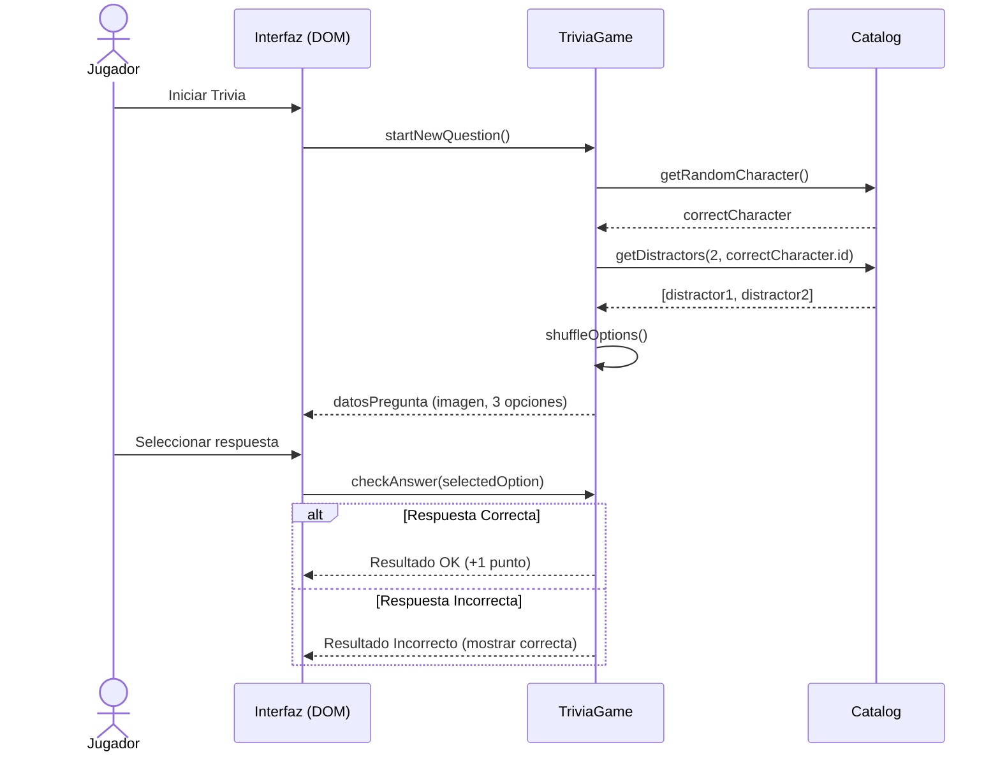

# Memoria técnica — Universo Disney & Trivia

> Versión 0.1 · Fase 1 (modelo de dominio) · Octubre 2026
>
> Las secciones marcadas con ✏️ o 🔴 representan puntos pendientes, preguntas del equipo o aspectos a refinar antes de programar.

---

## 1. Descripción del proyecto

Aplicación web interactiva dedicada al universo Disney. Un **Jugador / Visitante** puede explorar un catálogo de personajes, realizar búsquedas por texto y filtrados, abrir la ficha detallada de cada personaje (apariciones en películas, series, videojuegos, aliados y enemigos), gestionar una lista de favoritos y participar en un juego de trivia donde debe adivinar el nombre del personaje basándose en su imagen.

El catálogo se obtendrá dinámicamente desde una API pública externa ([Disney API](https://disneyapi.dev/)). La aplicación se desarrolla íntegramente en el lado del cliente sin backend propio.

### 1.1 Objetivos de aprendizaje
- Modelar un dominio real con clases en JavaScript, encapsulación y separación estricta de responsabilidades.
- Separar la **lógica de negocio** (Trivia, Favoritos, Catálogo) de la **presentación** (DOM) y del **acceso a datos** (API).
- Documentar requisitos, reglas de negocio y estructuras de datos **antes** de escribir código.

### 1.2 Alcance
| Dentro | Fuera |
|---|---|
| Catálogo, filtros y búsqueda de personajes | Backend propio o base de datos relacional/NoSQL |
| Ficha ampliada de personajes | Autenticación / Registro real con contraseña (se simula) |
| Juego de Trivia (adivinar personaje por imagen) | Juego multijugador en tiempo real |
| Gestión de favoritos en `localStorage` | Modificación, creación o borrado de personajes en la API |

---

## 2. Actores

| Actor | Descripción |
|---|---|
| **Jugador / Visitante** | Usuario que navega por el catálogo, consulta las fichas de personajes, gestiona sus favoritos y juega a la trivia. |
| **Sistema / API** | Fuente externa de los datos de los personajes ([disneyapi.dev](https://disneyapi.dev/)). |

---

## 3. Requisitos

### 3.1 Requisitos funcionales

| ID | Requisito | Actor | Prioridad | Fase |
|---|---|---|---|---|
| RF-01 | Listar el catálogo en tarjetas resumen (imagen y nombre) | Jugador | Alta | 1 |
| RF-02 | Buscar personajes por texto (coincidencia en el nombre) | Jugador | Media | 1 |
| 🔴 RF-03 | ✏️ *Filtrar el catálogo por criterios* | Jugador | Media | 1 |
| RF-04 | Ampliar la ficha al hacer clic (películas, series, videojuegos, aliados, enemigos) | Jugador | Alta | 1 |
| RF-05 | Iniciar una partida de trivia | Jugador | Alta | 1 |
| RF-06 | Responder una pregunta (imagen + 3 opciones de respuesta) | Jugador | Alta | 1 |
| 🔴 RF-07 | Registrarse con nombre de usuario (simulado) | Jugador | Media | 1 |
| RF-08 | Marcar / desmarcar personajes como favoritos | Jugador | Media | 2 |
| RF-09 | Conservar la lista de favoritos al recargar la página (`localStorage`) | Jugador | Media | 2 |
| RF-10 | Cargar los personajes desde la API de Disney | Sistema | Alta | 3 |
| RF-11 | Mostrar estados de carga (spinners) y errores al consultar la API | Jugador | Media | 3 |

### 3.2 Requisitos no funcionales

| ID | Requisito |
|---|---|
| RNF-01 | JavaScript vanilla (ES2022+), HTML5 y CSS3; sin frameworks ni librerías externas. |
| RNF-02 | Las clases de dominio no acceden directamente al DOM ni realizan llamadas `fetch`. |
| RNF-03 | Los errores de negocio se señalan con `throw new Error(...)`, no con `console.log`. |
| RNF-04 | Código y nombres de clases/métodos en inglés; textos visibles al usuario y documentación en español. |
| RNF-05 | Diseño responsive accesible en pantallas móviles y de escritorio. |

### 3.3 Historias de usuario (ejemplos)

- **HU-01** — *Como jugador, quiero buscar un personaje por su nombre para encontrarlo rápido.*
  - ✅ Al escribir "Mickey", solo se muestran los personajes cuyo nombre incluye ese texto.
  - ✅ Al limpiar la búsqueda vuelve a mostrarse el catálogo completo.
- **HU-02** — *Como jugador, quiero poner a prueba mis conocimientos en la trivia adivinando personajes.*
  - ✅ El juego muestra una imagen y tres opciones de respuesta.
  - ✅ El usuario selecciona una opción y el sistema indica si ha acertado o fallado, acumulando los puntos.
- **HU-03** — *Como jugador, quiero guardar mis personajes favoritos para consultarlos en cualquier momento.*
  - ✅ Hacer clic en la estrella añade/quita el personaje de favoritos.
  - ✅ La lista persiste tras reiniciar el navegador.
- ✏️ **HU-04** — *(propuesta del equipo)*

---

## 4. Reglas de negocio

| ID | Regla |
|---|---|
| 🔴 RN-01 | **Identificador único:** Se utilizará el identificador único `_id` devuelto por la API de Disney para mapear productos y favoritos. |
| RN-02 | Un personaje no puede estar duplicado en la lista de favoritos del mismo usuario. |
| 🔴 RN-03 | **Generación de la Trivia:** En cada pregunta, 1 opción es la correcta (asociada a la imagen) y 2 opciones son **distractores aleatorios** extraídos del resto del catálogo. |
| RN-04 | El orden de las 3 opciones presentadas en la trivia debe ser barajado aleatoriamente para evitar que la respuesta correcta ocupe siempre la misma posición. |
| 🔴 RN-05 | **Ronda de Trivia:** Una partida de trivia constará de un número determinado de preguntas o funcionará en modo continuo *(duda a resolver)*. |

---

## 5. API y mapeo de datos

### 5.1 Elección de la API

Se utiliza la API pública [Disney API](https://disneyapi.dev/).

**Motivos:** Aporta un catálogo amplio de personajes con su imagen (`imageUrl`), así como desglose por medios (películas, series, videojuegos) y relaciones (aliados, enemigos), ideal tanto para fichas explicativas como para alimentar el juego de preguntas.

### 5.2 Formato de un personaje en Disney API

`GET https://api.disneyapi.dev/character/{_id}`

```json
{
  "_id": 308,
  "films": ["Queen of Katwe"],
  "shortFilms": [],
  "tvShows": [],
  "videoGames": [],
  "parkAttractions": [],
  "allies": [],
  "enemies": [],
  "name": "Queen of Katwe",
  "imageUrl": "https://static.wikia.nocookie.net/disney/images/.../revision/latest?cb=...",
  "url": "https://api.disneyapi.dev/characters/308"
}
```

*Nota sobre la paginación:* La respuesta de la API devuelve un objeto envolvente:
`{ "data": [...], "info": { "totalPages": 149, "count": 50, ... } }`.

### 5.3 Mapeo API → modelo

| Campo API | Clase / propiedad | Transformación / Regla |
|---|---|---|
| `_id` | `Character.id` | Ninguna. Clave primaria en el modelo. |
| `name` | `Character.name` | Ninguna. |
| `imageUrl` | `Character.imageUrl` | 🔴 **Punto crítico:** Si viene `undefined` o `null`, se debe asignar una imagen local por defecto (*placeholder*). |
| `films` | `Character.films` | Array de strings (array vacío si no tiene). |
| `tvShows` | `Character.tvShows` | Array de strings. |
| `videoGames` | `Character.videoGames` | Array de strings. |
| `allies` | `Character.allies` | Array de strings. |
| `enemies` | `Character.enemies` | Array de strings. |

La conversión se centraliza en `Character.fromApi(json)` para independizar la capa UI y el modelo de posibles modificaciones en la estructura de la API.

---

## 6. Diseño del modelo

### 6.1 Decisiones de diseño

| Decisión | Motivo |
|---|---|
| Clase `Character` como modelo base | Contiene los datos puros del personaje y métodos auxiliares de validación/formato. |
| Clase `TriviaGame` separada de la UI | Maneja la puntuación, pregunta activa, selección de distractores y estado de la partida. |
| `FavoriteManager` persistente | Gestiona el almacenamiento de los IDs de favoritos en `localStorage`. |
| Manejo de excepciones con `throw` | Los fallos de validación (ej. intentar responder sin opciones) elevan un error que la UI captura para comunicarlo al usuario. |

### 6.2 Flujo de juego de Trivia



---

## 7. Plan de trabajo

| Fase | Entregable | Archivos |
|---|---|---|
| 1 | Modelo de clases, Trivia y lógica probados en consola | `src/model.js`, `src/demo.js` |
| 2 | Interfaz visual (Tarjetas, Ficha detallada, Trivia y Favoritos) | `index.html`, `styles.css`, `src/ui.js` |
| 3 | Conexión con Disney API y almacenamiento local | `src/api.js`, `src/storage.js` |

Arquitectura en 3 capas independientes:

```
ui.js  (DOM y eventos)  ──►  model.js (personajes, trivia, favs)  ◄──  api.js (fetch)
```

---

## 8. 🔴 Preguntas del equipo y puntos a refinar

### 🔴 RF-03 / Filtros
- **¿Bajo qué criterios exactos se filtrará el catálogo?**
  - *Opción A:* Por tipo de medio donde aparece (ej. "Tiene Películas", "Tiene Videojuegos", "Tiene Series").
  - *Opción B:* Por presencia de Aliados o Enemigos en su ficha.
  - *Opción C:* Filtro alfabético o por longitud del nombre.
- **¿El filtro actuará sobre todos los personajes de la API o solo sobre la página cargada actualmente en memoria?**

### 🔴 RF-07 / Usuario Simulado
- **¿Qué funcionalidad tendrá el nombre de usuario registrable?**
  - ¿Se usará para personalizar la pantalla de bienvenida y guardar sus puntuaciones récord de Trivia en `localStorage`?
  - ¿O servirá para asociar la lista de favoritos a ese usuario en particular?

### 🔴 Trivia / Mecánica de Juego
- **¿Cuántas preguntas conforman una ronda de Trivia?** (ej. Rondas de 5/10 preguntas con resumen final de puntuación, o modo infinito donde el jugador responde hasta que falla).
- **Control de imágenes faltantes:** ¿Qué ocurre si la API devuelve un personaje cuya `imageUrl` da error 404 o no existe? ¿Se descarta ese personaje para la Trivia?

### 🔴 Persistencia en LocalStorage
- **¿Cómo se almacenan los favoritos?**
  - Dado que `JSON.stringify` elimina los métodos de los objetos de clase, **se recomienda guardar solo un array con los `_id` de los personajes favoritos** (`["308", "512"]`) y luego buscarlos o reconstruirlos al iniciar la aplicación.